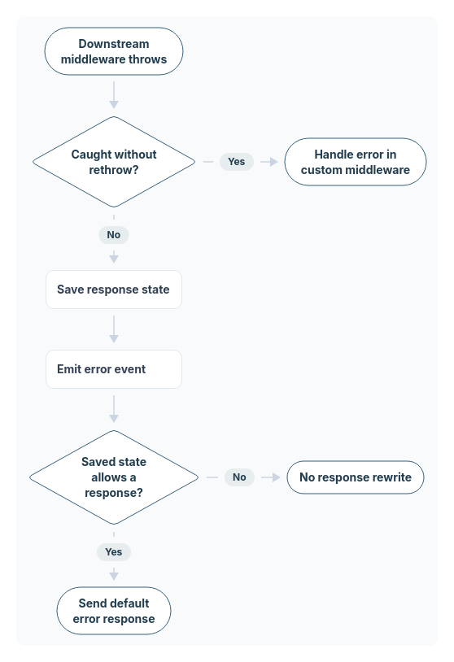

# Error Handling

## Try-Catch

  Using async functions means that you can try-catch `next`.
  This example adds a `.status` to all errors:

  ```js
  app.use(async (ctx, next) => {
    try {
      await next();
    } catch (err) {
      err.status = err.statusCode || err.status || 500;
      throw err;
    }
  });
  ```

### Default Error Handler

  The default error handler is essentially a `try-catch` at
  the very beginning of the middleware chain. To use a
  different error handler, simply put another `try-catch` at
  the beginning of the middleware chain, and handle the error
  there. However, the default error handler is good enough for
  most use cases. It will use a status code of `err.status`,
  or by default 500. If `err.expose` is true, then `err.message`
  will be the reply. Otherwise, a message generated from the
  error code will be used (e.g. for the code 500 the message
  "Internal Server Error" will be used). All headers will be
  cleared from the request, but any headers in `err.headers`
  will then be set. You can use a `try-catch`, as specified
  above, to add a header to this list.

  Here is an example of creating your own error handler:

```js
app.use(async (ctx, next) => {
  try {
    await next();
  } catch (err) {
    // will only respond with JSON
    ctx.status = err.statusCode || err.status || 500;
    ctx.body = {
      message: err.message
    };
  }
})
```

## The Error Event

  Error event listeners can be specified with `app.on('error')`.
  If no error listener is specified, a default error listener
  is used. Error listeners receive all errors that make their
  way back through the middleware chain, if an error is caught
  and not thrown again, it will not be passed to the error
  listener. If no error event listener is specified, then
  `app.onerror` will be used, which simply log the error unless
  `error.expose`is true or `app.silent` is true or `error.status`
  is 404.




[Edit diagram](https://svgdiagram.ai/diagram-sources/koa-middleware-error-flow?version=1).

For an error thrown by downstream middleware, catching it without rethrowing keeps
it out of Koa's default handler and its automatic `error` event. An uncaught or
rethrown error reaches `ctx.onerror`, which saves whether headers are already sent
or the response is not writable, then emits the event. It uses that saved state
for the fallback gate: an already-sent or non-writable response is not rewritten.
Changes made by error listeners do not change the saved decision. Custom middleware
can explicitly emit an event even when it handles the error.

[Download SVG](diagrams/middleware-error-flow.svg).
